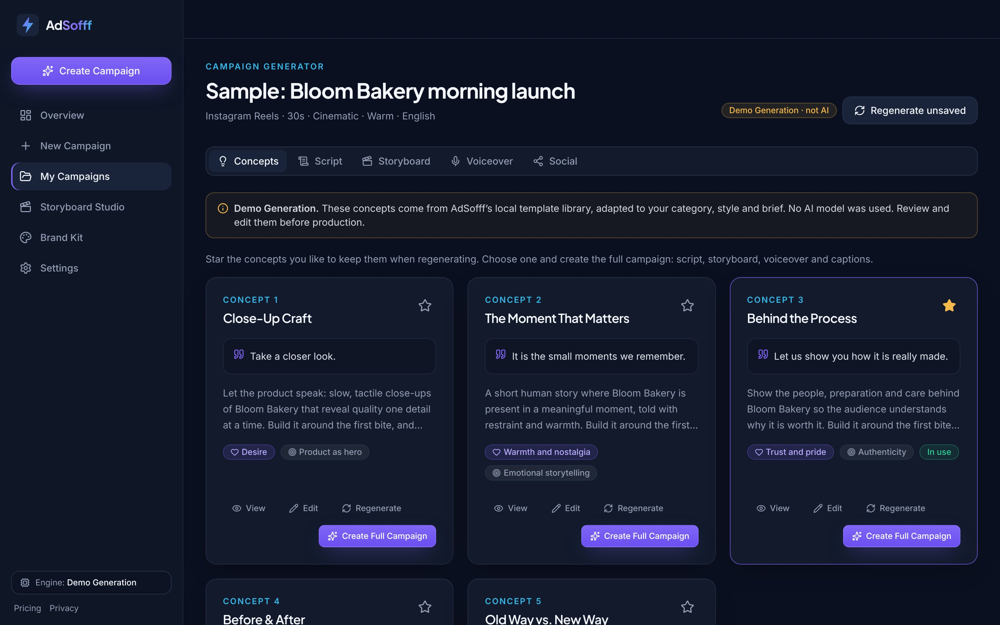
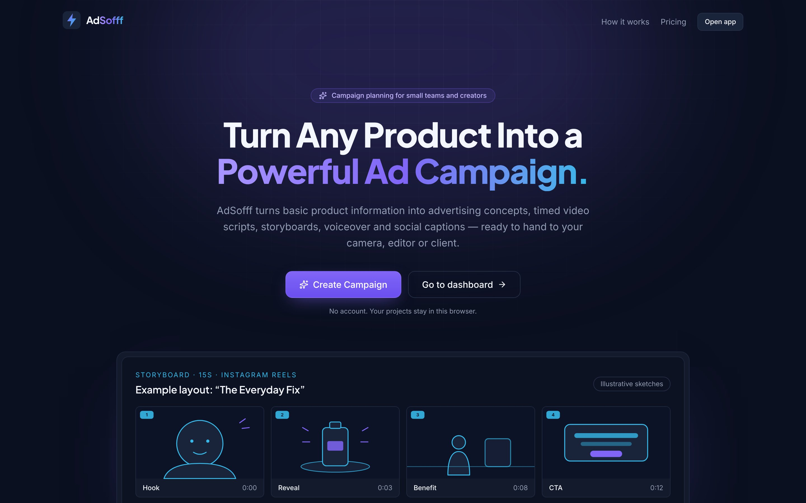
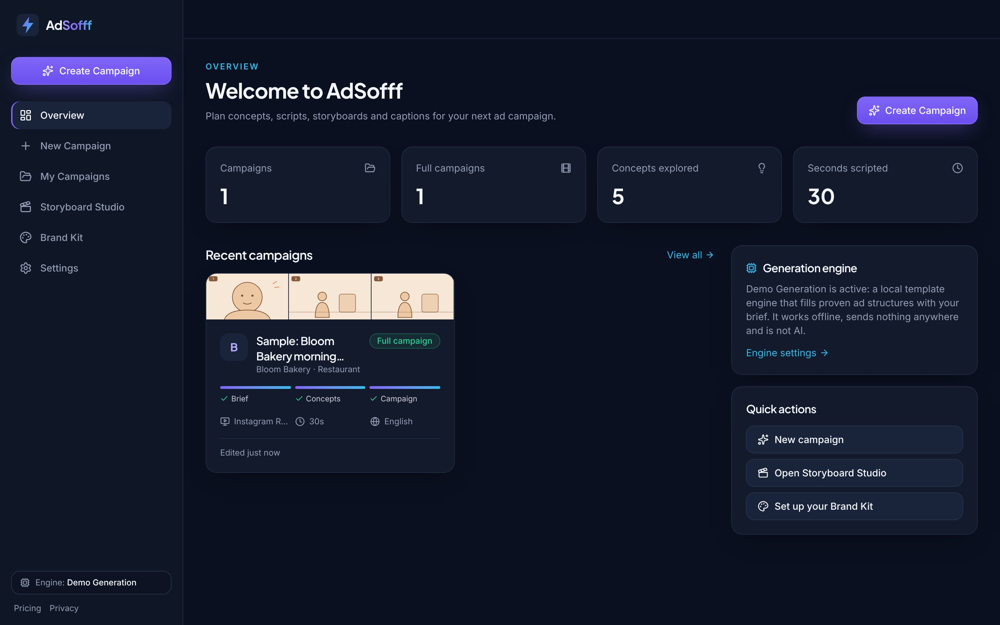
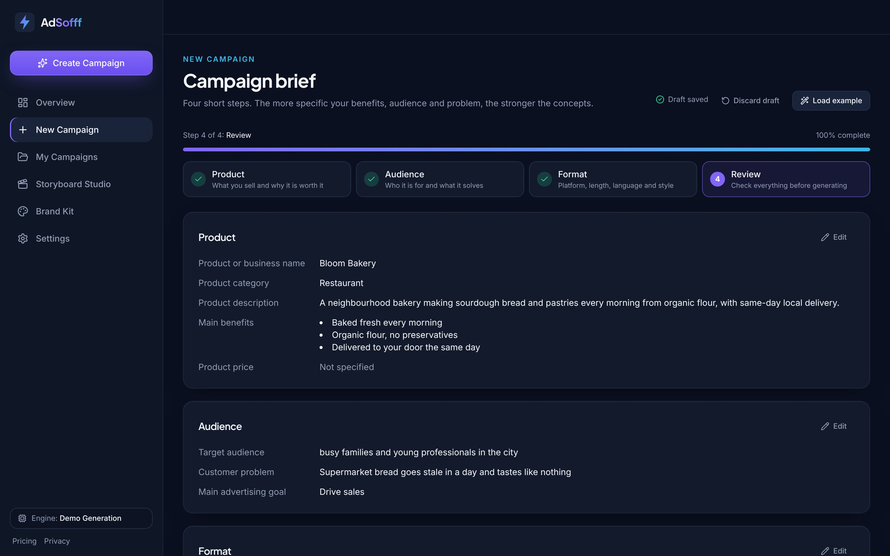
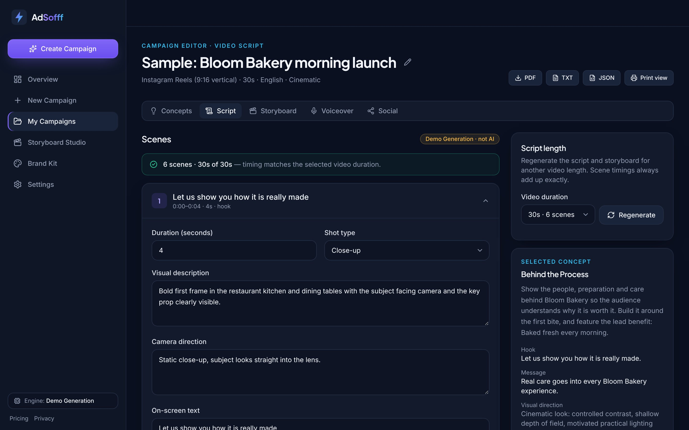
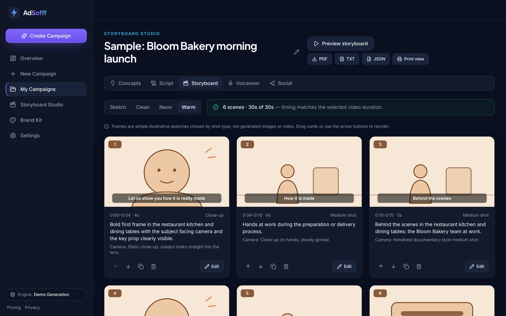
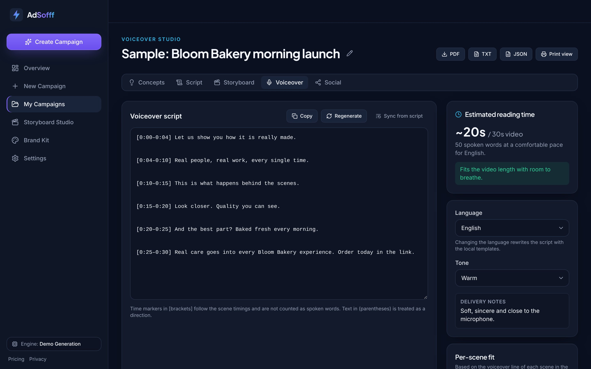
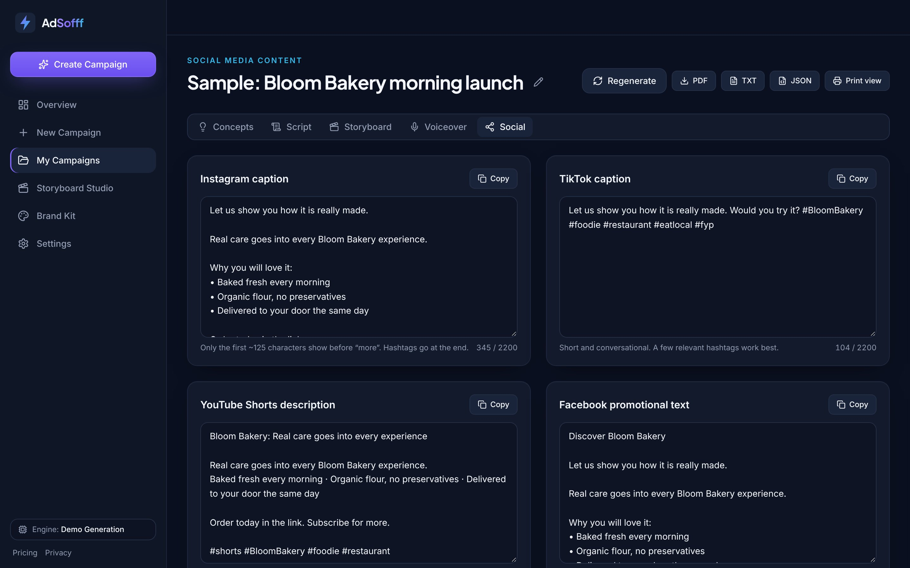
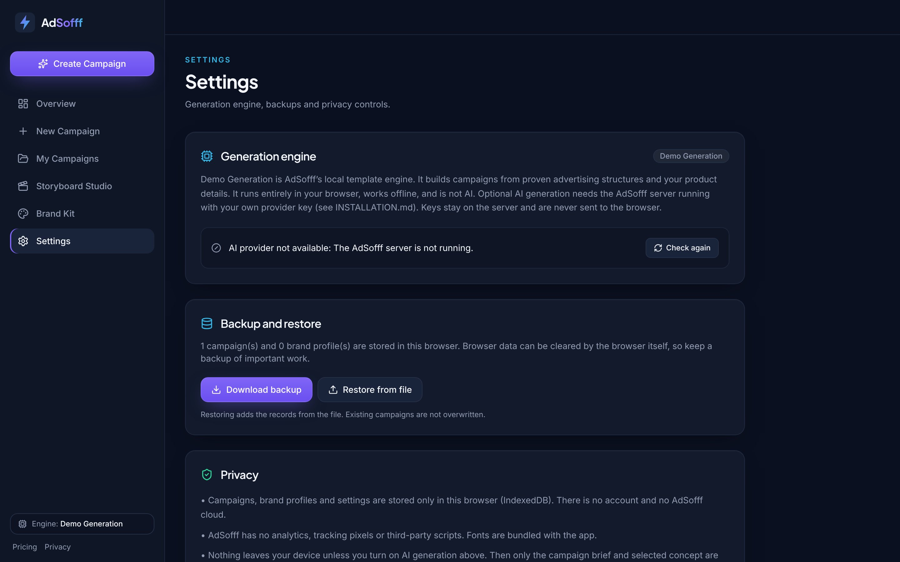

# AdSofff

**Turn Any Product Into a Powerful Ad Campaign.**

AdSofff turns a product brief into a complete advertising campaign plan: five distinct ad concepts, a timed video script, an editable storyboard, a voiceover script and platform-specific social media copy. Every campaign exports as a PDF report, a TXT script or a JSON project file.



## How content is generated

| Mode | When | What it is |
| --- | --- | --- |
| **Demo Generation** (default) | Always available, works offline | AdSofff's local template engine: 11 proven ad structures adapted to your category, style, language and brief. **It is not AI**, and the app labels it that way everywhere, including exports. |
| **AI generation** (optional) | Only when you run the AdSofff server with your own provider key **and** accept the data notice in Settings | Anthropic or OpenAI (or an OpenAI-compatible endpoint) through a server-side proxy that uses the official SDKs. Keys never reach the browser. |

The AI path is implemented and covered by automated tests against local mock providers. It has **not** been run against a live provider account in this release (see Known limitations).

## Quick start (Windows, macOS, Linux)

```bash
cd adsofff
npm install
npm run dev
```

Open http://localhost:5173 and click **Open a sample campaign** to see a finished campaign. Exact Windows steps: [INSTALLATION.md](INSTALLATION.md).

## Scripts

| Command | What it does |
| --- | --- |
| `npm run dev` | Development server (Demo Generation) |
| `npm run dev:full` | Development server + AdSofff API server (for optional AI) |
| `npm run build` | Type-check, build to `dist/`, then verify no server code or secrets are in the bundle |
| `npm start` | Serve the built app and the API on http://localhost:8787 |
| `npm run lint` | ESLint (TypeScript + React Hooks rules, zero warnings allowed) |
| `npm test` | Unit and integration tests (Vitest) |
| `npm run test:e2e` | Browser tests (Playwright; run `npm run build` first) |
| `npm run export-demo` | Regenerate the sample exports in `docs/demo/` |
| `npm run build:standalone` | Build the offline single-file edition (`dist-standalone/index.html`) |
| `npm run build:gumroad` | Build the buyer package `gumroad/dist/AdSofff-v<version>.zip` (see `gumroad/UPLOAD-CHECKLIST.md`) |

## Screenshots

All screenshots are of the running application with the built-in sample campaign.

| | |
| --- | --- |
|  |  |
|  |  |
|  |  |
|  |  |

Sample exports: [PDF](docs/demo/sample-campaign.pdf) · [TXT](docs/demo/sample-campaign.txt) · [JSON](docs/demo/sample-campaign.adsofff.json)

## Project structure

```
adsofff/
├─ src/
│  ├─ lib/
│  │  ├─ schemas.ts           Zod schemas and types (shared with the server)
│  │  ├─ engine/              Demo Generation engine (archetypes, category profiles, EN/AZ/TR/RU copy)
│  │  ├─ ai/provider.ts       GenerationProvider interface: local and remote providers
│  │  ├─ campaignForm.ts      4-step brief: validation, progress, local drafts
│  │  ├─ db.ts, backup.ts     IndexedDB storage, backup/restore and import validation
│  │  ├─ export/              Report model, PDF (jsPDF + DejaVu), TXT, downloads
│  │  ├─ demoCampaign.ts      Built-in sample campaign
│  │  └─ files.ts             Safe logo upload validation
│  ├─ store/app.ts            Zustand store with debounced persistence
│  ├─ components/             Design system, layout, campaign cards, storyboard sketches
│  └─ pages/                  Landing, Pricing, Dashboard, New Campaign, Generator, Editor,
│                             Storyboard, Voiceover, Social, Campaigns, Brand Kit, Settings, Print
├─ server/                    Optional AI proxy (Node http + official Anthropic/OpenAI SDKs)
├─ e2e/                       Playwright tests (+ mock AI provider for tests only)
├─ scripts/                   Dev runner, bundle secret check, sample export
└─ docs/                      Screenshots and sample exports
```

## Tech stack

React 19, TypeScript 5.9, Vite 8, Tailwind CSS 4, React Router 7, Zustand, Lucide icons, IndexedDB, jsPDF, Zod 4, Vitest, Playwright, ESLint. Server: Node built-ins, Zod, `@anthropic-ai/sdk`, `openai`, run with `tsx`.

## Product honesty rules

- Demo Generation is always labelled “Demo Generation · not AI”.
- Storyboard frames are labelled as illustrative sketches, never as generated images or video.
- AdSofff writes voiceover scripts; it does not generate audio.
- AdSofff does not post to social networks; you copy the text.
- Pricing editions are shown as proposals. There is no billing, checkout or entitlement system.
- The sample campaign uses a fictional business and is named “Sample: …”.

## Documentation

[INSTALLATION](INSTALLATION.md) · [USER_GUIDE](USER_GUIDE.md) · [FEATURES](FEATURES.md) · [PRIVACY](PRIVACY.md) · [CHANGELOG](CHANGELOG.md) · [LICENSE-DRAFT](LICENSE-DRAFT.md)
